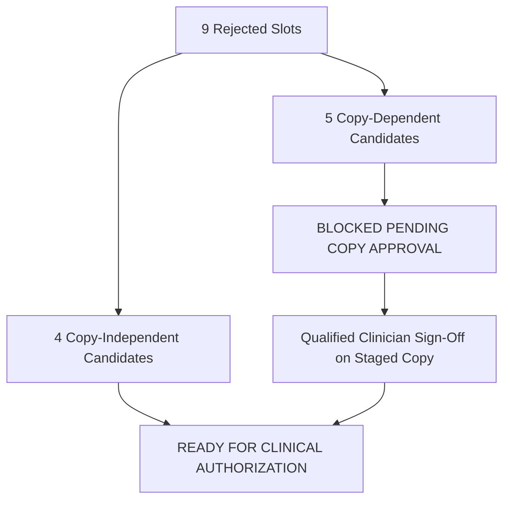

# Content & Release Acceptance Plan: HealthCalendar365
**Baseline:** Technical Review 7 (`REMEDIATION_ROUND7_REVIEW_2026-10-16.md`) | **Date:** October 16, 2026
**Status:** PRODUCTION HOLD ACTIVE — ZERO APPROVED ASSETS

> [!IMPORTANT]
> **PRODUCTION HOLD IS STRICTLY ACTIVE.** The approval ledger in `data/approved_manifest.json` remains strictly at **0 APPROVED**, **31 PENDING_CLINICAL_SIGN_OFF**, and **9 REJECTED_MISMATCH**. No external image generation APIs (Gemini/Imagen) have been invoked, no credits spent, no live assets promoted, no production datasets altered, and no public deployments performed. This review packet stages all technical and editorial materials for human and clinical reviewer decisions.

---
## 1. Project Identity & Approval Ledger State
- **Repository Target:** `D:\HealthCalendar365` (100% isolated; `D:\Health-Message-` preserved completely untouched).
- **Technical Gate Baseline:** Review 7 confirmed closure of all backup-preflight, test-isolation, and manifest-build failure handling defects.
- **Current Approval Ledger Summary (`data/approved_manifest.json`):**
  - **Total Dedicated Audit Cards:** 40
  - **APPROVED:** `0` (Zero promotion without clinical sign-off)
  - **PENDING_CLINICAL_SIGN_OFF:** `31` (Awaiting qualified clinical reviewer evaluation)
  - **REJECTED_MISMATCH:** `9` (Identified visual/clinical discrepancies flagged for candidate re-specification)

---
## 2. Machine-Readable Review Queue Summary
A machine-readable queue has been compiled at [`review/review_queue.json`](file:///d:/HealthCalendar365/review/review_queue.json) containing complete clinical metadata for all 40 cards across the 10 dedicated spotlight posters:

| Poster ID | Observance / Theme | Total Cards | Pending Sign-Off | Rejected Mismatch |
| :--- | :--- | :---: | :---: | :---: |
| `10-15` | Global Handwashing Day | 4 | 4 | 0 |
| `10-15-cane` | World White Cane Day | 4 | 4 | 0 |
| `10-16` | World Food Day | 4 | 4 | 0 |
| `10-16-spine` | World Spine Day | 4 | 4 | 0 |
| `10-17` | World Trauma Day (Road Safety & Golden Hour) | 4 | 4 | 0 |
| `10-18` | World Menopause Day | 4 | 4 | 0 |
| `10-19` | Ear & Hearing Health (Daily Guidance) | 4 | 4 | 0 |
| `10-19-oral` | Oral Health & Tobacco-Free Life | 4 | 3 | 1 (Card 2) |
| `10-20` | World Osteoporosis Day | 4 | 0 | 4 (Cards 1–4) |
| `10-21` | Global Iodine Deficiency Disorders Prevention Day | 4 | 0 | 4 (Cards 1–4) |
| **TOTALS** | **10 Dedicated Posters** | **40** | **31** | **9** |

---
## 3. Specifications & Prompts for the 9 Rejected Cards
Full candidate specifications and generation prompts are detailed in [`review/candidate_specifications_9_rejected.json`](file:///d:/HealthCalendar365/review/candidate_specifications_9_rejected.json). Clinical discrepancies and instruction overloads have been resolved prior to drafting prompts.

Candidate prompts are strictly partitioned into two categories:
1. **READY_FOR_CLINICAL_AUTHORIZATION (4 candidates):** Visuals are independent of copy changes.
2. **BLOCKED_PENDING_COPY_APPROVAL (5 candidates):** Visuals directly depend on unresolved medical/editorial copy changes. **Image generation for these slots is strictly blocked until a qualified clinical reviewer approves the revised copy.**



### A. Copy-Independent Candidates (Ready for Clinical Authorization)

#### 10-19-oral_card2: Rinse Mouth Vigorously After Meals
- **Current Bilingual Copy:**
  - *English Title:* Rinse Mouth Vigorously After Meals
  - *Gujarati Title:* કંઈપણ ખાધા પછી સ્વચ્છ પાણીના કોગળા કરો
  - *English Desc:* Rinsing removes trapped carbohydrate debris, neutralizes plaque acids, and prevents enamel erosion.
  - *Gujarati Desc:* જમ્યા પછી કે નાસ્તો કર્યા પછી મોંમાં સ્વચ્છ પાણી ભરીને જોરથી કોગળા કરો; દાંતમાં સડો થતો અટકે છે.
- **Rejection Cause:** Visual Concordance FAIL: Displayed plastic interdental flossing picks instead of vigorous water mouth rinsing after meals.
- **Clinical Safety Guardrails:**
  - Must depict plain clean water mouth rinsing at washbasin.
  - Strictly NO dental floss, plastic floss picks, or toothpicks.
  - Positive clinical hygiene polarity.
- **Required Visual Objects/Actions:** Indian adult at a modern, clean domestic washbasin, swishing clear water with puffed cheeks, preparing to spit into sink. Clean drinking tumbler nearby.
- **Prohibited Elements:** Dental floss thread or plastic flosser sticks, commercial toothpaste branding, distorted teeth.
- **Status:** `READY_FOR_CLINICAL_AUTHORIZATION`
- **Staged Generation Prompt:**
  ```text
  Ultra-photorealistic 4:3 close-up photograph of an Indian individual actively rinsing mouth with water at a clean, modern ceramic washbasin after a meal. The person has water in mouth with puffed cheeks during a vigorous swish, leaning slightly forward over the sink. A simple clear glass water tumbler rests on the counter. Natural indoor morning lighting, authentic Indian domestic bathroom or wash area setting, clean clinical hygiene, cinematic depth of field, 8k resolution, editorial medical quality. Strictly NO dental floss, NO flosser picks, NO toothpicks, NO logos, NO text.
  ```

#### 10-20_card1: Bright Lighting & Bathroom Grab Bars
- **Current Bilingual Copy:**
  - *English Title:* Bright Lighting & Bathroom Grab Bars
  - *Gujarati Title:* ઘરમાં પૂરતો પ્રકાશ અને બાથરૂમમાં ગ્રેબ-બાર
  - *English Desc:* Install sturdy stainless steel grab bars beside toilets, keep night lights on, and remove throw rugs.
  - *Gujarati Desc:* વડીલો માટે બાથરૂમમાં મજબૂત ગ્રેબ-બાર લગાવો, રાત્રે અજવાળું રાખો અને લપસી જાય તેવી સાદડીઓ હટાવો.
- **Rejection Cause:** Visual Concordance & Cultural Authenticity FAIL: Legacy western stock senior in unauthentic setting lacking sturdy stainless steel bathroom grab bars.
- **Clinical Safety Guardrails:**
  - Depict an authentic Indian senior in domestic environment.
  - Grab bar must be sturdy, wall-anchored stainless steel, positioned ergonomically.
  - Bathroom floor must be visibly dry with non-slip tiles.
- **Required Visual Objects/Actions:** Indian senior citizen (65+ years) safely and confidently gripping a wall-mounted stainless steel grab bar in a well-lit Indian domestic bathroom with dry matte tiles.
- **Prohibited Elements:** Western hospital ward stock look, wet or slippery glossy marble floors, distorted limbs.
- **Status:** `READY_FOR_CLINICAL_AUTHORIZATION`
- **Staged Generation Prompt:**
  ```text
  Ultra-photorealistic 4:3 close-up photograph of an elderly Indian senior citizen (65+ years) safely gripping a sturdy, wall-mounted brushed stainless steel bathroom grab bar in a brightly lit Indian home bathroom. The bathroom has clean, dry, matte non-slip floor tiles and warm morning lighting. Dignified posture, authentic Indian domestic setting, clean clinical fall-prevention environment, cinematic depth of field, 8k resolution, editorial medical journal quality. No text, no logos, no distorted limbs, no slippery wet puddles.
  ```

#### 10-20_card2: Weight-Bearing Walks & Ragi / Sesame Nutrition
- **Current Bilingual Copy:**
  - *English Title:* Weight-Bearing Walks & Ragi / Sesame Nutrition
  - *Gujarati Title:* રોજિંદી ચાલવાની કસરત અને રાગી-તલનો આહાર
  - *English Desc:* Daily walking stimulates osteoblasts to build bone. Include calcium-rich ragi, sesame, paneer and curd.
  - *Gujarati Desc:* દરરોજ પગપાળા ચાલવાથી હાડકાં મજબૂત થાય છે. આહારમાં રાગીની રોટલી, સફેદ તલ અને પનીરનો ઉપયોગ વધારો.
- **Rejection Cause:** Visual Concordance & Cultural Authenticity FAIL: Stock park walk lacking Indian elders and calcium-rich dietary context.
- **Clinical Safety Guardrails:**
  - Must highlight traditional Indian calcium sources: ragi, white sesame (til), paneer, curd, alongside walking elders.
  - Do NOT recommend unprescribed pharmaceutical mega-dose calcium pills.
- **Required Visual Objects/Actions:** Active elderly Indian couple walking briskly in a sunlit Indian garden park during morning golden hours. Inset or foreground display of traditional ragi, white sesame seeds, and fresh paneer.
- **Prohibited Elements:** Non-Indian stock models, synthetic pills or pharmaceutical bottles, sedentary/frail postures.
- **Status:** `READY_FOR_CLINICAL_AUTHORIZATION`
- **Staged Generation Prompt:**
  ```text
  Ultra-photorealistic 4:3 photograph of active elderly Indian couple walking briskly along a paved walking path in a sunlit Indian garden park during golden morning hours, wearing comfortable walking shoes and cotton attire. Soft natural morning sunlight illuminating them. A tasteful inset or subtle foreground display of traditional Indian calcium foods: ragi grains, small bowl of white sesame seeds, and fresh paneer. Warm authentic Indian lifestyle, healthy bone aging, cinematic depth of field, 8k resolution, editorial medical quality. No text, no logos, no pills.
  ```

#### 10-21_card1: Store Iodized Salt in Airtight Jars
- **Current Bilingual Copy:**
  - *English Title:* Store Iodized Salt in Airtight Jars
  - *Gujarati Title:* આયોડાઇઝ્ડ મીઠું હવાચુસ્ત બરણીમાં ઢાંકીને રાખો
  - *English Desc:* Always buy sealed packets with the smiling sun iodized logo. Store in airtight ceramic or glass jars.
  - *Gujarati Desc:* હંમેશા પેક કરેલું આયોડાઇઝ્ડ મીઠું ખરીદો અને તેને કાચ કે ચિનાઈ માટીની હવાચુસ્ત બરણીમાં ઢાંકીને રાખો.
- **Rejection Cause:** Visual Concordance & Cultural Authenticity FAIL: Refrigerator plastic storage containers lacking Indian kitchen setting with traditional airtight ceramic/glass salt jars.
- **Clinical Safety Guardrails:**
  - Show fine iodized salt stored in airtight ceramic (barni) or glass container.
  - Indicate sealed packaged salt with smiling sun icon concept.
  - Do NOT recommend storing salt in the refrigerator (moisture risk).
- **Required Visual Objects/Actions:** Authentic Indian kitchen counter with a traditional glazed ceramic jar (barni) or heavy glass airtight jar, scooping clean fine white salt with a dry wooden or stainless spoon.
- **Prohibited Elements:** Plastic refrigerator crisper bins, damp surfaces, commercial brand names.
- **Status:** `READY_FOR_CLINICAL_AUTHORIZATION`
- **Staged Generation Prompt:**
  ```text
  Ultra-photorealistic 4:3 close-up photograph of an authentic Indian kitchen counter featuring a traditional ceramic barni (glazed white and brown porcelain jar) with an airtight lid, and a clear glass jar containing fine white iodized salt. A small wooden spoon is resting beside the open jar showing clean dry powdered salt. In the background sits a sealed salt packet with a generic smiling sun iodized logo. Warm natural kitchen lighting, clean hygiene, authentic Indian domestic setting, cinematic depth of field, 8k resolution, editorial quality. No commercial brand logos, no text.
  ```

---

### B. Copy-Dependent Candidates (BLOCKED Pending Copy Sign-Off)

#### 10-20_card3: Slip, Trip & Fall Hazards at Home
- **Current Bilingual Copy:**
  - *English Title:* Regular Movement & Postural Balance
  - *Gujarati Title:* બેઠાડુ જીવન છોડી નિયમિત સક્રિયતા
  - *English Desc:* Wet floors and loose electrical wires are the #1 cause of catastrophic hip fractures in elders.
  - *Gujarati Desc:* ફ્લોર ભીનો ન રાખો; અંધારામાં ચાલવું કે ફ્લોર પર વાયરો રાખવાથી વડીલો લપસીને થાપાનું ફ્રેક્ચર ભોગવી શકે છે.
- **Rejection Cause:** Visual Concordance & Cultural Authenticity FAIL: Generic slip-and-fall graphic lacking authentic Indian elder domestic setting; clinical title/desc mismatch in DB.
- **Staged Copy Revisions:**
  - *Proposed EN Title:* Eliminate Slip, Trip & Fall Hazards at Home
  - *Proposed GU Title:* ઘરમાં લપસી પડવાના અને ઠોકર ખાવાના જોખમો દૂર કરો
  - *Proposed EN Desc:* Slippery wet floors and loose cords are a leading avoidable cause of falls and hip fractures in elders.
  - *Proposed GU Desc:* ભીનો ફ્લોર અને છૂટા વાયરો વડીલોમાં થાપાના ફ્રેક્ચરનું એક મુખ્ય ટાળી શકાય તેવું કારણ છે.
- **Clinical Safety Guardrails:**
  - Depict hazard resolution (clear walkways, baseboard-routed cords).
  - Avoid fear-mongering graphic depictions of catastrophic injury.
- **Status:** ⛔ `BLOCKED_PENDING_COPY_APPROVAL` (Requires clinician approval of staged title/desc revision `REQUIRES_APPROVAL_OF_STAGED_TITLE_10_20_CARD3`).
- **Staged Generation Prompt:**
  ```text
  Ultra-photorealistic 4:3 photograph of an Indian elder living room demonstrating fall hazard prevention: completely clear, uncluttered walkways with electrical cords safely bound and secured along the wall baseboard. A senior Indian grandfather is standing steadily and upright near a firm armchair, wearing non-slip footwear. Warm natural indoor daylight, dry matte tiled flooring, authentic Indian domestic setting, clinical fall-prevention safety, cinematic depth of field, 8k resolution, editorial medical standard. No text, no warning icons, no injured bodies.
  ```

#### 10-20_card4: Limit Excessive Salt Intake & Choose Wholesome Hydration
- **Current Bilingual Copy:**
  - *English Title:* Non-Slip Flooring & Lighting
  - *Gujarati Title:* લપસણા ફ્લોરિંગ સામે સુરક્ષા
  - *English Desc:* High sodium and dark aerated sodas deplete bone calcium through urinary leaching, creating porous brittle bones.
  - *Gujarati Desc:* કાચું મીઠું છાંટવું અને સોડા-કોલ્ડડ્રિંક્સ પીવાથી હાડકાંમાંથી કેલ્શિયમ પેશાબ વાટે ધોવાઈ જાય છે અને હાડકાં પોલાં બને છે.
- **Rejection Cause:** Visual Concordance & Medical Accuracy FAIL: Current text and previous prompt preserved unsupported causal claim that dark sodas directly leach bone calcium; IOF guidance states there is no firm evidence that fizzy drinks weaken bones.
- **Staged Copy Revisions:**
  - *Proposed EN Title:* Limit Excessive Salt Intake & Choose Wholesome Hydration
  - *Proposed GU Title:* વધુ પડતું મીઠું ટાળો અને પૂરતું પાણી-છાશ પીઓ
  - *Proposed EN Desc:* Excessive dietary salt increases urinary calcium loss. For adults, keep total salt from all foods below 5 g/day (equivalent to less than 2 g/day sodium). Choose water or traditional unsalted buttermilk.
  - *Proposed GU Desc:* વધારે પડતું મીઠું ખાવાથી પેશાબ વાટે કેલ્શિયમ નીકળી જાય છે; પુખ્ત વયના લોકો માટે દિવસભરના બધા ખોરાકમાંથી મળતું કુલ મીઠું ૫ ગ્રામથી ઓછું રાખો (આશરે ૨ ગ્રામથી ઓછું સોડિયમ). પાણી અથવા મીઠું ઉમેર્યા વગરની છાશ પસંદ કરો.
- **Clinical Safety Guardrails:**
  - IOF guidance ([IOF: Protein and Other Nutrients](https://www.osteoporosis.foundation/patients/prevention/protein-other-nutrients)) explicitly separates excessive salt/caffeine from unsupported soda claims.
  - Do NOT depict corroded bones or dark soda as chemically dissolving skeleton.
  - For adults, distinguish total dietary salt below 5 g/day from sodium below 2 g/day; use unsalted chaas or water. Proposed copy remains pending qualified review.
- **Status:** ⛔ `BLOCKED_PENDING_COPY_APPROVAL` (Requires clinician approval of revised medical claim `REQUIRES_APPROVAL_OF_STAGED_TITLE_AND_DESC_10_20_CARD4`).
- **Staged Generation Prompt:**
  ```text
  Ultra-photorealistic 4:3 close-up photograph of an Indian dining table setting demonstrating healthy bone nutrition: a glass of fresh homemade buttermilk (chaas) and clean water in clear focus, with an open salt shaker pushed away to the background. Wholesome Indian meal with stainless steel thali, warm natural daylight, editorial clinical nutrition focus, cinematic depth of field, 8k resolution, medical journal quality. Strictly NO brand logos, NO text labels, NO graphic illustrations of corroded bones.
  ```

#### 10-21_card2: Add Iodized Salt Towards the End of Cooking
- **Current Bilingual Copy:**
  - *English Title:* Add Iodized Salt Towards the End of Cooking
  - *Gujarati Title:* રાંધતી વખતે મીઠું છેલ્લે ઉમેરવાની ટેવ પાડો
  - *English Desc:* Excessive prolonged boiling evaporates volatile iodine. Add salt near the finish to preserve full iodine value.
  - *Gujarati Desc:* વધારે ઉકાળવાથી આયોડિન ઉડી જાય છે; શાક કે દાળ ઉતારતી વખતે છેલ્લે મીઠું ઉમેરવાથી આયોડિન જળવાઈ રહે છે.
- **Rejection Cause:** Visual Concordance & Food Science FAIL: Salad shield graphic lacks Indian cooking context; copy previously claimed volatile potassium iodate evaporates.
- **Staged Copy Revisions:**
  - *Proposed EN Desc:* Prolonged high-heat boiling can degrade and leach fortified iodine compounds. Adding iodized salt towards the end of cooking helps retain full micronutrient value.
  - *Proposed GU Desc:* લાંબા સમય સુધી વધુ ગરમીમાં ઉકાળવાથી આયોડિનનું પ્રમાણ ઘટી શકે છે; રસોઈ પૂરી થવાના સમયે મીઠું ઉમેરવાથી આયોડિનનું મૂલ્ય જળવાય છે.
- **Clinical Safety Guardrails:**
  - Potassium iodate ($KIO_3$) is a non-volatile ionic salt (melting point >500°C); it does not evaporate into air. Degradation occurs via chemical reduction, thermal degradation, and aqueous leaching (WHO Food Fortification Guidelines, Part 3).
  - Show measured small spoon addition in authentic Indian vessel (kadai/pot).
- **Status:** ⛔ `BLOCKED_PENDING_COPY_APPROVAL` (Requires clinician approval of food science revision `REQUIRES_APPROVAL_OF_STAGED_DESC_10_21_CARD2`).
- **Staged Generation Prompt:**
  ```text
  Ultra-photorealistic 4:3 close-up photograph of an Indian home cook's hand gently adding a measured small spoon of fine iodized salt into a traditional stainless steel kadai containing freshly cooked vegetable curry (sabzi) near the end of cooking. Gentle soft steam rising, authentic Indian home kitchen, natural warm lighting, cinematic depth of field, 8k resolution, editorial culinary medicine standard. Strictly NO raw salad, NO commercial logos, NO oversized salt pouring.
  ```

#### 10-21_card3: Avoid Unbranded Loose Coarse Salt
- **Current Bilingual Copy:**
  - *English Title:* Dry & Airtight Salt Storage
  - *Gujarati Title:* મીઠાને ભેજ અને ગરમીથી બચાવો
  - *English Desc:* Unbranded loose coarse salt lacks iodine; iodine deficiency in pregnant mothers leads to child mental retardation.
  - *Gujarati Desc:* ખુલ્લું બિન-આયોડાઇઝ્ડ મીઠું વાપરશો નહીં; આયોડિનની કમીથી બાળકોમાં માનસિક મંદતા અને ગલગંડ (ગોઇટર) થાય છે.
- **Rejection Cause:** Visual Concordance & Cultural Authenticity FAIL: Generic rock salt visual without authentic Indian market/kitchen context; title/desc conflict in DB.
- **Staged Copy Revisions:**
  - *Proposed EN Title:* Avoid Unbranded Loose Coarse Salt
  - *Proposed GU Title:* ખુલ્લું અને બિન-આયોડાઇઝ્ડ મીઠું વાપરવાનું ટાળો
- **Clinical Safety Guardrails:**
  - Do NOT imply rock salt (sendha namak) is naturally iodized.
  - Do NOT recommend eating more salt; recommend switching exclusively to iodized salt.
- **Status:** ⛔ `BLOCKED_PENDING_COPY_APPROVAL` (Requires clinician approval of staged title revision `REQUIRES_APPROVAL_OF_STAGED_TITLE_10_21_CARD3`).
- **Staged Generation Prompt:**
  ```text
  Ultra-photorealistic 4:3 photograph of an educational comparison in an authentic Indian grocery or kitchen: in clear focus, a clean sealed packet of fine iodized salt with a sun logo, placed beside an open unbranded rustic gunny sack of coarse grey crystal rock salt with a subtle push-away composition. Clean lighting, authentic Indian grocery context, focus on maternal and child thyroid health protection, cinematic depth of field, 8k resolution, editorial public health quality. No text slogans, no brand trademarks, no disfiguring medical anomalies.
  ```

#### 10-21_card4: Protect Salt from Direct Stove Heat & Moisture
- **Current Bilingual Copy:**
  - *English Title:* Balanced Micronutrient Diet
  - *Gujarati Title:* પૂરતાં પોષક તત્ત્વોવાળો આહાર
  - *English Desc:* Direct kitchen stove heat and open damp containers rapidly degrade potassium iodate from salt.
  - *Gujarati Desc:* મીઠાની બરણીને ક્યારેય ખુલ્લી કે ગેસની જ્વાળાની એકદમ નજીક ન રાખો; ગરમીથી આયોડિન નાશ પામે છે.
- **Rejection Cause:** Visual Concordance FAIL: Unrelated food panel lacking iodized salt storage and thermal degradation focus; title/desc conflict in DB.
- **Staged Copy Revisions:**
  - *Proposed EN Title:* Protect Salt from Direct Stove Heat & Moisture
  - *Proposed GU Title:* મીઠાની બરણી ગેસની જ્વાળા અને ભેજથી દૂર રાખો
- **Clinical Safety Guardrails:**
  - Demonstrate correct storage distance: salt jar kept in a dry pantry cupboard away from stove burners.
- **Status:** ⛔ `BLOCKED_PENDING_COPY_APPROVAL` (Requires clinician approval of staged title revision `REQUIRES_APPROVAL_OF_STAGED_TITLE_10_21_CARD4`).
- **Staged Generation Prompt:**
  ```text
  Ultra-photorealistic 4:3 photograph showing proper salt storage in an Indian kitchen: a neatly sealed ceramic salt container placed inside a cool, dry, well-ventilated wooden pantry cabinet, at a safe distance away from the hot gas cooking range visible in the soft background. Clean, authentic Indian home kitchen, warm natural lighting, clinical educational standard for preserving volatile micronutrients, cinematic depth of field, 8k resolution, editorial quality. No logos, no text.
  ```

---
## 4. English / Gujarati Clinical Agreement, Terminology & Medical Claims Audit
All 40 cards were evaluated for clinical agreement, translation fidelity, medical claim veracity, and typography. Proposed changes are categorized into **Editorial/Grammar Proposals** (requiring a qualified Gujarati language reviewer) vs **Medical Claim / Clinical Revisions** (requiring an identifiable, qualified clinical reviewer):

| Slot | Category | Current Text | Proposed Text | Evidence Source & Clinical Rationale | Reviewer Type Required |
| :--- | :--- | :--- | :--- | :--- | :--- |
| `10-15_day_title` | EDITORIAL_GRAMMAR | **EN:** Global Handwashing Day<br>**GU:** વિશ્વ હાથ ધોવાના દિવસ (ગ્લોબલ હેન્ડવોશિંગ ડે) | **EN:** Global Handwashing Day<br>**GU:** વિશ્વ હાથ ધોવા દિવસ (ગ્લોબલ હેન્ડવોશિંગ ડે) | Corrects Gujarati genitive case marker ('ધોવાના' -> 'ધોવા'). Standard Gujarati public health phrasing. | Qualified Gujarati Language Reviewer |
| `10-15_card2_desc` | MEDICAL_CLAIM_REVISION | **EN:** ...clean under fingernails where 80% of germs hide.<br>**GU:** ...નખના ભાગમાં ૨૦ સેકન્ડ ઘસીને સાબુ લગાવો જ્યાં મોટાભાગના કીટાણુ છુપાયેલા હોય છે. | **EN:** ...clean under fingernails where pathogens and dirt frequently accumulate.<br>**GU:** ...નખના ભાગમાં ૨૦ સેકન્ડ ઘસીને સાબુ લગાવો જ્યાં ધૂળ અને કીટાણુઓ સૌથી વધુ જમા થાય છે. | [CDC Clean Hands FAQ](https://www.cdc.gov/clean-hands/faq/index.html): CDC supports scrubbing under nails and between fingers for at least 20 seconds, but does NOT establish an exact '80%' statistic. Replaces unsupported number with evidence-backed clinical phrasing. | Qualified Clinical Reviewer |
| `10-16-spine_card4_desc` | BIOMECHANICAL_CLAIM_CONTEXT | **EN:** Bending neck forward puts 27 kg of pressure on cervical vertebrae. Hold your smartphone up closer to eye level.<br>**GU:** મોબાઈલમાં સતત નીચું જોવાથી ડોકના મણકા પર ૨૭ કિલો વજન આવે છે... | **EN:** Severe forward neck flexion significantly increases mechanical load on cervical vertebrae. Hold devices closer to eye level and change posture frequently.<br>**GU:** ડોક વધારે પડતી નીચી નમાવવાથી સર્વાઇકલ મણકા પર ભારે દબાણ આવે છે; ફોનને આંખની સામે રાખો અને વચ્ચે-વચ્ચે ગરદન હળવી કરો. | The 27 kg (60 lbs) figure originates from a specific 2014 mathematical finite element model (Hansraj KK, Surg Technol Int 25:277-9). Clinical ergonomics emphasizes frequent posture variation over a rigid static weight claim. | Qualified Clinical Reviewer |
| `10-17_card3_title` | EDITORIAL_ALIGNMENT | **EN:** Controlled Speed & Helmet Discipline<br>**GU:** નિયંત્રિત ગતિ અને હેલ્મેટ શિસ્ત | **EN:** Controlled Speed & Zero Phone Distraction<br>**GU:** નિયંત્રિત ગતિ અને ફોનથી સાવધાની | Card 1 already covers helmet discipline; Card 3 description covers mobile phones and speeding. Clarifies title to match body copy. | Qualified Editorial Reviewer |
| `10-18_card3_and_card4` | CLINICAL_INVERSION_CORRECTION | **EN:** Card 3 Title: Bone Density & Joint Care (Desc: hot flashes & consulting gynecologist) \| Card 4 Title: Qualified Gynecologist Consultation (Desc: diet & caffeine)<br>**GU:** કાર્ડ ૩: હાડકાંની મજબૂતી (વર્ણન: ગાયનેકોલોજિસ્ટની સલાહ) \| કાર્ડ ૪: ગાયનેકોલોજિસ્ટની સલાહ (વર્ણન: ચા-કૉફીથી પરેજી) | **EN:** Card 3 Title: 'Consult Gynecologist for Menopause Symptoms' \| Card 4 Title: 'Moderate Caffeine, Sugar & Spices'<br>**GU:** કાર્ડ ૩: 'મેનોપોઝના લક્ષણો માટે ગાયનેકોલોજિસ્ટની સલાહ' \| કાર્ડ ૪: 'ચા, કૉફી અને વધુ પડતી ખાંડની પરેજી' | Severe semantic title/desc inversion. Aligns card titles with their respective medical advice. International Menopause Society (IMS) White Paper guidelines. | Qualified Clinical Reviewer |
| `10-20_card3_title_and_desc` | CLINICAL_CONFLICT_AND_EPIDEMIOLOGY | **EN:** Title: Regular Movement & Postural Balance \| Desc: ...are the #1 cause of catastrophic hip fractures...<br>**GU:** શીર્ષક: બેઠાડુ જીવન છોડી નિયમિત સક્રિયતા \| વર્ણન: ...થાપાનું ફ્રેક્ચર ભોગવી શકે છે. | **EN:** Title: 'Eliminate Slip, Trip & Fall Hazards at Home' \| Desc: 'Slippery wet floors and loose cords are a leading avoidable cause of falls and hip fractures in elders.'<br>**GU:** શીર્ષક: 'ઘરમાં લપસી પડવાના અને ઠોકર ખાવાના જોખમો દૂર કરો' \| વર્ણન: 'ભીનો ફ્લોર અને છૂટા વાયરો વડીલોમાં થાપાના ફ્રેક્ચરનું એક મુખ્ય ટાળી શકાય તેવું કારણ છે.' | Resolves title/desc conflict. Moderates '#1 cause' claim to 'a leading avoidable cause' per IOF Fall Prevention Guidelines and WHO Global Report on Falls Prevention in Older Age. | Qualified Clinical Reviewer |
| `10-20_card4_title_and_desc` | MEDICAL_EVIDENCE_REVISION (UNSUPPORTED SODA CLAIM) | **EN:** Title: Non-Slip Flooring & Lighting \| Desc: High sodium and dark aerated sodas deplete bone calcium through urinary leaching, creating porous brittle bones.<br>**GU:** શીર્ષક: લપસણા ફ્લોરિંગ સામે સુરક્ષા \| વર્ણન: કાચું મીઠું છાંટવું અને સોડા-કોલ્ડડ્રિંક્સ પીવાથી હાડકાંમાંથી કેલ્શિયમ પેશાબ વાટે ધોવાઈ જાય છે... | **EN:** Title: 'Limit Excessive Salt Intake & Choose Wholesome Hydration' \| Desc: 'Excessive dietary salt increases urinary calcium loss. For adults, keep total salt from all foods below 5 g/day (equivalent to less than 2 g/day sodium). Choose water or traditional unsalted buttermilk.'<br>**GU:** શીર્ષક: 'વધુ પડતું મીઠું ટાળો અને પૂરતું પાણી-છાશ પીઓ' \| વર્ણન: 'વધારે પડતું મીઠું ખાવાથી પેશાબ વાટે કેલ્શિયમ નીકળી જાય છે; પુખ્ત વયના લોકો માટે દિવસભરના બધા ખોરાકમાંથી મળતું કુલ મીઠું ૫ ગ્રામથી ઓછું રાખો (આશરે ૨ ગ્રામથી ઓછું સોડિયમ). પાણી અથવા મીઠું ઉમેર્યા વગરની છાશ પસંદ કરો.' | [IOF Guidance: Protein and Other Nutrients](https://www.osteoporosis.foundation/patients/prevention/protein-other-nutrients): IOF explicitly confirms there is **no firm evidence that fizzy soft drinks directly weaken bones**. Excessive dietary sodium (>5g/day) is a proven cause of hypercalciuria. Staged copy removes unsupported causal claim about dark sodas while promoting evidence-based sodium moderation and healthy hydration. | Qualified Clinical Reviewer |
| `10-21_card2_desc` | FOOD_CHEMISTRY_AND_STABILITY | **EN:** Excessive prolonged boiling evaporates volatile iodine. Add salt near the finish to preserve full iodine value.<br>**GU:** વધારે ઉકાળવાથી આયોડિન ઉડી જાય છે; શાક કે દાળ ઉતારતી વખતે છેલ્લે મીઠું ઉમેરવાથી આયોડિન જળવાઈ રહે છે. | **EN:** Prolonged high-heat boiling can degrade and leach fortified iodine compounds. Adding iodized salt towards the end of cooking helps retain full micronutrient value.<br>**GU:** લાંબા સમય સુધી વધુ ગરમીમાં ઉકાળવાથી આયોડિનનું પ્રમાણ ઘટી શકે છે; રસોઈ પૂરી થવાના સમયે મીઠું ઉમેરવાથી આયોડિનનું મૂલ્ય જળવાય છે. | [WHO / FAO Guidelines on Food Fortification with Micronutrients, Part 3](https://www.who.int/docs/default-source/micronutrients/gff-part-3-en.pdf): Potassium iodate ($KIO_3$) is a non-volatile ionic salt (melting point >500°C); it does not evaporate into air. Micronutrient loss occurs through thermal reduction and aqueous leaching. Replaces inaccurate volatility claim with valid food chemistry. | Qualified Clinical Reviewer |
| `10-21_card3_title` | CLINICAL_CONFLICT_RESOLUTION | **EN:** Dry & Airtight Salt Storage<br>**GU:** મીઠાને ભેજ અને ગરમીથી બચાવો | **EN:** Avoid Unbranded Loose Coarse Salt<br>**GU:** ખુલ્લું અને બિન-આયોડાઇઝ્ડ મીઠું વાપરવાનું ટાળો | Resolves redundancy with Cards 1 & 4. Description focuses on unfortified coarse salt leading to iodine deficiency disorders. Safety: Does not imply rock salt is naturally iodized; does not recommend eating more salt. | Qualified Clinical Reviewer |
| `10-21_card4_title` | CLINICAL_CONFLICT_RESOLUTION | **EN:** Balanced Micronutrient Diet<br>**GU:** પૂરતાં પોષક તત્ત્વોવાળો આહાર | **EN:** Protect Salt from Direct Stove Heat & Moisture<br>**GU:** મીઠાની બરણી ગેસની જ્વાળા અને ભેજથી દૂર રાખો | Title was generic 'balanced micronutrient diet', while description specifically warns against stove burner heat and open damp containers degrading iodate. Aligns title with storage instruction. FSSAI Salt Storage Guidelines. | Qualified Clinical Reviewer |

> [!NOTE]
> All proposed copy changes remain strictly in review staging [`review/proposed_copy_and_provenance_corrections.json`](file:///d:/HealthCalendar365/review/proposed_copy_and_provenance_corrections.json). No changes will be merged into `data/health_365.json` until explicit clinical reviewer sign-off is granted.

---
## 5. Health Observance & Sponsoring Body Provenance Verification
Each health observance was audited against primary authoritative registries to separate formal international days from grassroots initiatives, awareness dates, and organization-neutral daily health guidance:

| Day ID | Observance Name | Date | Sponsoring Body / Origin | Attribution Category | Verification Status |
| :--- | :--- | :--- | :--- | :--- | :--- |
| `10-15` | Global Handwashing Day | October 15 | Global Handwashing Partnership (GHP) | `OFFICIAL_SPONSOR_VERIFIED` | **VERIFIED** |
| `10-15-cane` | World White Cane Day / White Cane Safety Day | October 15 | World Blind Union (WBU) / National Federation of the Blind (NFB) | `HISTORICAL_ADVOCACY_OBSERVANCE` | **VERIFIED** (Advocacy day; US 1964 proclamation; not a formal UN treaty day) |
| `10-16` | World Food Day | October 16 | Food and Agriculture Organization of the United Nations (FAO) | `OFFICIAL_UN_AGENCY_VERIFIED` | **VERIFIED** (UN General Assembly Res 34/83) |
| `10-16-spine` | World Spine Day | October 16 | World Federation of Chiropractic (WFC) / Global Alliance for Musculoskeletal Health | `ORGANIZATIONAL_CAMPAIGN_VERIFIED` | **VERIFIED** |
| `10-17` | World Trauma Day (World Trauma Prevention Day) | October 17 | Initiated in India (Trauma Association of India / KEM Hospital Mumbai) | `ORGANIZATION_NEUTRAL_DAILY_GUIDANCE` | **VERIFIED AS DAILY GUIDANCE** (2011 origin retained as historical context pending primary charter; WHO badge prohibited) |
| `10-18` | World Menopause Day | October 18 | International Menopause Society (IMS) in collaboration with WHO | `OFFICIAL_SPONSOR_VERIFIED` | **VERIFIED** |
| `10-19` | Ear & Hearing Health | October 19 | None (Daily Health Guidance) | `ORGANIZATION_NEUTRAL_DAILY_GUIDANCE` | **VERIFIED** (Routine guidance; official WHO World Hearing Day is March 3) |
| `10-19-oral` | Oral Health & Tobacco-Free Life | October 19 | None (Daily Health Guidance) | `ORGANIZATION_NEUTRAL_DAILY_GUIDANCE` | **VERIFIED** (Routine guidance; official FDI World Oral Health Day is March 20) |
| `10-20` | World Osteoporosis Day | October 20 | International Osteoporosis Foundation (IOF) | `OFFICIAL_SPONSOR_VERIFIED` | **VERIFIED** |
| `10-21` | Global Iodine Deficiency Disorders Prevention Day | October 21 | Supported by Iodine Global Network (IGN) advocacy | `ORGANIC_AWARENESS_DATE_NOT_UN_OFFICIAL` | **VERIFIED AS ORGANIC AWARENESS DATE** (IGN explicitly confirms it is NOT a recognized official event; sponsoring coalition unverified) |

### Key Provenance Findings:
1. **October 21 Global Iodine Deficiency Disorders Prevention Day:**
   - [IGN dedicated publication](https://ign.org/latest/blog/our-hopes-on-world-iodine-deficiency-prevention-day/) explicitly states:
     > *"Observed every year on October 21, World Iodine Deficiency Prevention Day is an organically developed awareness date rather than a recognized official event."*
   - Therefore, describing October 21 as an "Official UN/WHO designated international day" or claiming an official sponsoring coalition is factually incorrect. It is designated as `ORGANIC_AWARENESS_DATE_NOT_UN_OFFICIAL` with an **Iodine Deficiency Prevention Guidance** badge.
2. **October 17 World Trauma Day:**
   - Originated in 2011 in India (Trauma Association of India / KEM Hospital Mumbai) to combat road traffic mortalities and promote the 'Golden Hour'. **It is not an official UN or WHO designated international day.** Placing a WHO badge is prohibited. It is appropriately designated with an **Organization-Neutral Daily Guidance Badge** ('Emergency Trauma Care Guidance').
3. **October 15 White Cane Safety Day:**
   - Recognized historically via 1964 US Congressional Joint Resolution and commemorated globally by the World Blind Union (WBU). It is designated as `HISTORICAL_ADVOCACY_OBSERVANCE`, not a formal UN treaty day.
4. **October 19 Guidance Cards (`10-19` Ear Care & `10-19-oral` Oral Health):**
   - Official WHO World Hearing Day is March 3, and World Oral Health Day is March 20. October 19 cards provide routine primary care education and are accurately designated with **Organization-Neutral Daily Guidance Badges** without false agency sponsorship.

---
## 6. Rendered Poster Verification (Narrowed Scope: STRUCTURAL_RENDER_PASS)
All 10 dedicated spotlight posters were rendered in headless Chromium using `HealthPosterRenderer` across both layout formats and all three language modes (60 PNG files).

> [!WARNING]
> **SCOPE CLARIFICATION ON "60/60 PASS":** The automated render script strictly checks **canvas dimension conformance** ($1080\times1080$, $1080\times1920$) and **DOM image element loading** ($4/4$ card images present).
>
> It does **NOT** verify:
> - Text clipping, overflow, or line truncation
> - Contrast ratios or visual legibility against card backgrounds
> - Safe cropping boundaries across square vs vertical aspect ratios
> - Clinical accuracy of active artwork
> - Gujarati linguistic agreement or correct ligature shaping under mobile compression
> - Physical WhatsApp delivery
>
> Therefore, all 60 outputs are labeled **`STRUCTURAL_RENDER_PASS`**, while **Visual Review**, **Clinical Review**, and **Mobile Delivery** remain separate, explicit pending gates. Existing-content review renders contain known rejected artwork and are presented strictly as forensic unapproved evidence.

### Summary of Render Execution Metrics:
- **Total Posters Rendered:** `60 / 60` (10 posters × 2 formats × 3 languages)
- **Square Format ($1080\times1080$ px):** 30 PNG outputs (WhatsApp Feed / Post)
- **Vertical Format ($1080\times1920$ px):** 30 PNG outputs (WhatsApp Status / Story)
- **Language Breakdown:** 20 English, 20 Gujarati, 20 Bilingual
- **Technical Status Breakdown:**
  - `technical_structural_pass`: **60** (`STRUCTURAL_RENDER_PASS`)
  - `technical_structural_warning`: **0**
  - `technical_structural_fail`: **0**
- **Governance Status Breakdown:**
  - `visual_review_pending`: **60** (`PENDING_HUMAN_REVIEW`)
  - `clinical_review_pending`: **60** (`PENDING_CLINICAL_REVIEW`)
  - `mobile_delivery_not_tested`: **60** (`NOT_TESTED`)
- **Font Context Verification:** Google Fonts 'Noto Sans Gujarati' and 'Plus Jakarta Sans' loaded and validated via `document.fonts.check()` (40 fonts loaded in browser context).
- **Render Manifest:** Full execution metrics recorded in [`review/rendered_posters/render_manifest.json`](file:///d:/HealthCalendar365/review/rendered_posters/render_manifest.json).
- **Script Path Reproducibility:** `review/render_all_60_posters.cjs` cleanly resolves `APP_ROOT = path.resolve(__dirname, '..')`, supports optional `--app-root` and `--out-dir` CLI flags, and was verified via isolated `--test-one` execution.

---
## 7. Mobile PWA & WhatsApp Field Delivery Checklist
As specified in the acceptance protocol, hardware-dependent field delivery checks are cataloged below and designated as **NOT TESTED** pending physical device execution:

| Verification Item | Target Platform | Test Specification | Verification Status |
| :--- | :--- | :--- | :---: |
| **Installed PWA Service Worker Registration** | Android Chrome / Edge | Clean installation, registration of `sw.js`, precache population of all 12 core assets + WOFF2 fonts | **NOT TESTED** (Requires target device) |
| **Offline PWA Launch & Poster Generation** | Android Chrome (Airplane Mode) | Launch from home screen without network, load stored calendar data, render canvas poster offline | **NOT TESTED** (Requires target device) |
| **Dynamic Cache Eviction & Origin Storage** | Android Chromium | Verify cache limit boundaries, cache quota management, and unpolluted origin storage | **NOT TESTED** (Requires target device) |
| **WhatsApp Status Share (1080×1920)** | Android WhatsApp (Target App) | Direct Web Share API trigger / blob download, upload to 24h WhatsApp Status, verify no compression text-clipping | **NOT TESTED** (Requires target device) |
| **WhatsApp Post / Group Share (1080×1080)** | Android WhatsApp (Target App) | Share square poster to WhatsApp group, verify readability of Gujarati conjuncts under aggressive JPEG/WebP compression | **NOT TESTED** (Requires target device) |
| **Gujarati Complex Glyphs Rendering** | Mobile WebKit / Chromium | Verify ligatures and matras ('દ્વારા', 'શ્રવણ', 'ઓસ્ટીયોપોરોસીસ', 'શ્રી અન્ન') render without dotted circles | **NOT TESTED** (Requires target device) |

---
## 8. Technical Regression & State Invariance
- **Automated Test Suites:** Executed all four regression suites:
  - `test_remediation_round3.py`: **PASS** (Image decoding, aspect ratio $1200\times600$ rejection, rollback, recovery)
  - `test_remediation_round4.py`: **PASS** (Missing backup fail-closed, corrupt pointer quarantine, dry-run invariance, contradictory QA rejection, provenance)
  - `test_remediation_round5.py`: **PASS** (Preflight corrupt backup rejection, missing pre-transaction hashes, dry-run zero mutation, active promotion QA rejection)
  - `test_remediation_round6.py`: **PASS** (Builder `project_dir` isolation, live worker non-mutation, recovery/rollback failure blocking, recording stub parameter inspection)
- **Live Source Invariance:** SHA-256 comparison of live project files verified zero unintended changes or deletions across all 207 files.

---
## 9. Deliverables & Required Human Sign-Off Checklist
All requested deliverables are staged under `d:\HealthCalendar365\review\`:
1. [`review/CONTENT_RELEASE_ACCEPTANCE.md`](file:///d:/HealthCalendar365/review/CONTENT_RELEASE_ACCEPTANCE.md) (Master acceptance plan)
2. [`review/REVIEW_PACKET.md`](file:///d:/HealthCalendar365/review/REVIEW_PACKET.md) (Detailed visual review packet with inline markdown image embeds for all 40 cards & 60 renders)
3. [`review/index.html`](file:///d:/HealthCalendar365/review/index.html) (Interactive, standalone browsable HTML review packet with side-by-side comparisons and full-size renders)
4. [`review/review_queue.json`](file:///d:/HealthCalendar365/review/review_queue.json) (Machine-readable 40-card audit queue)
5. [`review/candidate_specifications_9_rejected.json`](file:///d:/HealthCalendar365/review/candidate_specifications_9_rejected.json) (Candidate specs & prompts for the 9 rejected slots, partitioned into 4 ready vs 5 blocked)
6. [`review/proposed_copy_and_provenance_corrections.json`](file:///d:/HealthCalendar365/review/proposed_copy_and_provenance_corrections.json) (Staged copy and provenance corrections with full citations)
7. [`review/rendered_posters/`](file:///d:/HealthCalendar365/review/rendered_posters/) (60 high-resolution PNG renders + `render_manifest.json`)

### Specific Next Decisions / Actions Required to Lift Production Hold:
1. **Clinical & Language Review Decisions:**
   - **Language Reviewer:** Verify the Gujarati genitive correction for `10-15_day_title` ('ધોવાના' -> 'ધોવા').
   - **Clinical Reviewer:** Review and approve the 31 pending cards in [`review/review_queue.json`](file:///d:/HealthCalendar365/review/review_queue.json).
   - **Clinical Reviewer:** Authorize the 5 blocked staged copy changes:
     - `10-18` (cards 3 & 4 title swap)
     - `10-20 Card 3` (fall hazards title/desc revision)
     - `10-20 Card 4` (moderate salt & wholesome hydration; removal of causal soda claim per IOF)
     - `10-21 Card 2` (food chemistry timing & non-volatile salt explanation per WHO)
     - `10-21 Cards 3 & 4` (unbranded loose salt avoidance & stove heat protection titles)
2. **Replacement Image Generation Authorization:**
   - Authorize candidate generation for the 4 copy-independent slots (`10-19-oral_card2`, `10-20_card1`, `10-20_card2`, `10-21_card1`).
   - Unblock and authorize candidate generation for the remaining 5 slots only after clinical approval of their revised copy.
3. **Target Device Field Testing:**
   - Execute the 6 items on the Android/PWA/WhatsApp checklist on a physical mobile device.

**STOPPING POINT REACHED. Production hold remains active. Awaiting user review and authorization.**

### Salt and sodium unit correction — review only (October 16, 2026)
For adults, WHO recommends less than 2 g/day sodium, equivalent to less than 5 g/day total dietary salt from all foods. Gujarati proposal: પુખ્ત વયના લોકો માટે દિવસભરના બધા ખોરાકમાંથી મળતું કુલ મીઠું ૫ ગ્રામથી ઓછું રાખો (આશરે ૨ ગ્રામથી ઓછું સોડિયમ). This is a staged correction awaiting qualified clinical and Gujarati review; candidate generation remains blocked where copy approval is pending. Source: [WHO sodium reduction](https://www.who.int/news-room/fact-sheets/detail/sodium-reduction).
