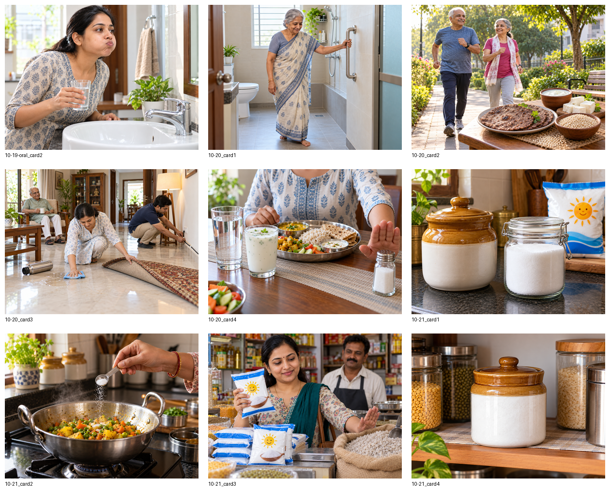

# Nine Replacement Image Candidates

**Status:** Staging only; production hold active.

All nine candidates passed PNG decode, 1200×900 dimensions, and exact 4:3 aspect ratio checks. Existing live images remain unchanged until user approval.

**Final prompt set:** Each numbered scene below was generated as ultra-photorealistic editorial public-health photography in an authentic Indian setting, composed for safe square and vertical poster crops. Shared constraints were realistic anatomy, no commercial branding, no readable text, no watermark, and no unrelated clinical objects. Card-specific required and prohibited elements are stated in each scene description and bound in `review/NINE_CANDIDATE_PILOT_PLAN.json`.

## 1. `10-19-oral_card2` — Rinse Mouth Vigorously After Meals

- File: `photos/staging/candidate_10_19_oral_card2_v1.png`
- SHA-256: `e9c9b5762eff9648ab700190cd92d896c7cdf00b73e6e1b5df8b683af07a93bb`
- Scene: Indian adult visibly swishing plain water at a clean home washbasin; no flossing.
- Technical validation: **PASS**
- Human visual decision: **PENDING USER APPROVAL**

## 2. `10-20_card1` — Bright Lighting & Bathroom Grab Bars

- File: `photos/staging/candidate_10_20_card1_v1.png`
- SHA-256: `26dbb852beccf2358c471fe69bcffb5c6562bbc514ece89eb365908b6b64f1c8`
- Scene: Indian senior using a securely mounted stainless-steel bathroom grab bar on a dry floor.
- Technical validation: **PASS**
- Human visual decision: **PENDING USER APPROVAL**

## 3. `10-20_card2` — Weight-Bearing Walks & Ragi / Sesame Nutrition

- File: `photos/staging/candidate_10_20_card2_v1.png`
- SHA-256: `347402abd8e1ceb3aa90fcff170ebda99a2198975344260bf809f858d13afed0`
- Scene: Active Indian seniors walking with ragi roti, sesame, paneer and curd visible.
- Technical validation: **PASS**
- Human visual decision: **PENDING USER APPROVAL**

## 4. `10-20_card3` — Eliminate Slip, Trip & Fall Hazards at Home

- File: `photos/staging/candidate_10_20_card3_v1.png`
- SHA-256: `28a0205f55286945f252a5ec448c1f22464bd18e3d12a39f63c9fbb312e32f4a`
- Scene: Indian family wiping a spill, securing a cord and removing a loose rug while an elder waits safely.
- Technical validation: **PASS**
- Human visual decision: **PENDING USER APPROVAL**

## 5. `10-20_card4` — Limit Excessive Salt Intake & Choose Wholesome Hydration

- File: `photos/staging/candidate_10_20_card4_v1.png`
- SHA-256: `5de63340092a8d6a0f29116ea330690e00199dc7d396dc3082199d020a7edfe7`
- Scene: Indian meal with water and buttermilk while a hand moves the salt shaker away.
- Technical validation: **PASS**
- Human visual decision: **PENDING USER APPROVAL**

## 6. `10-21_card1` — Store Iodized Salt in Airtight Jars

- File: `photos/staging/candidate_10_21_card1_v1.png`
- SHA-256: `762e775811b51e4659137729049cd527bbe877332d3cba87d086e8637b95972b`
- Scene: Airtight ceramic and glass iodized-salt containers in an Indian kitchen.
- Technical validation: **PASS**
- Human visual decision: **PENDING USER APPROVAL**

## 7. `10-21_card2` — Add Iodized Salt Towards the End of Cooking

- File: `photos/staging/candidate_10_21_card2_v1.png`
- SHA-256: `fca3971d212004b4cccbb4f4b5efd4b2fe39906f54a5b8f893ff4eeef5ac04f2`
- Scene: One measured spoon of iodized salt added to cooked sabzi in a steel kadai.
- Technical validation: **PASS**
- Human visual decision: **PENDING USER APPROVAL**

## 8. `10-21_card3` — Avoid Unbranded Loose Coarse Salt

- File: `photos/staging/candidate_10_21_card3_v1.png`
- SHA-256: `d4ec74ea78c05daeb54fa16aa83e2f705545f03428bd1c59d1b49fd8b523ca37`
- Scene: Indian shopper selects sealed iodized salt and pushes aside an unbranded loose-salt sack.
- Technical validation: **PASS**
- Human visual decision: **PENDING USER APPROVAL**

## 9. `10-21_card4` — Keep Iodized Salt Dry & Covered

- File: `photos/staging/candidate_10_21_card4_v1.png`
- SHA-256: `f5481ee5ce7ea4f6cb985997fd7ab6685f584be8f2cbcd8c5165b1905c716153`
- Scene: Tightly closed salt container on a clean, dry Indian pantry shelf.
- Technical validation: **PASS**
- Human visual decision: **PENDING USER APPROVAL**
